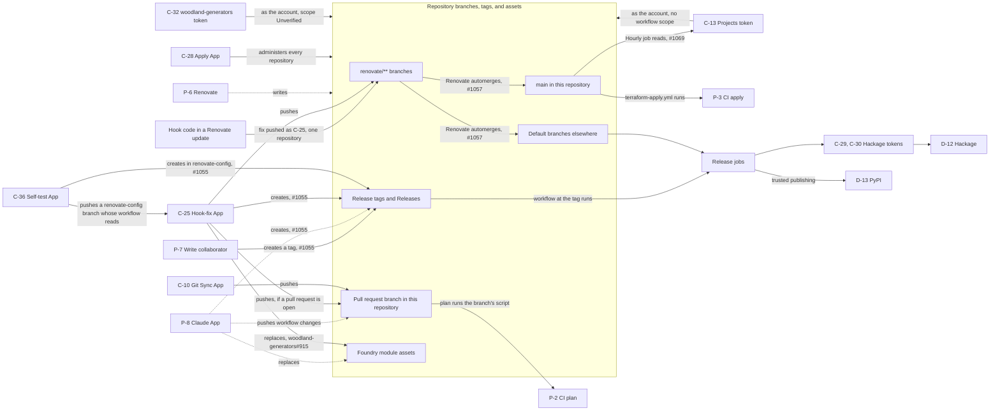
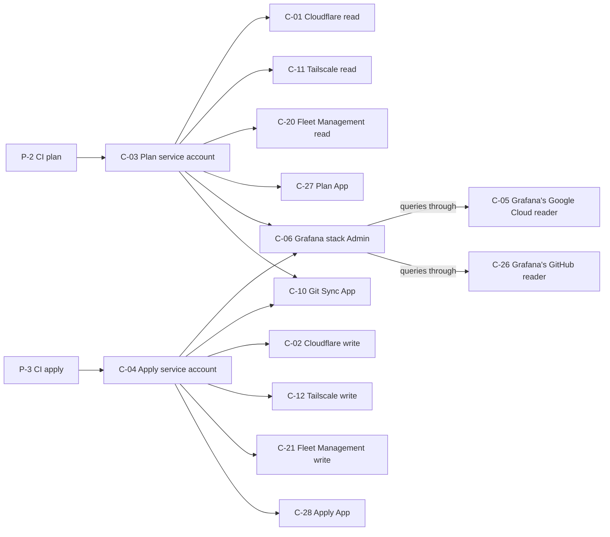

<!-- SPDX-FileCopyrightText: 2026 Alex Brandt <alunduil@gmail.com> -->
<!-- SPDX-License-Identifier: MIT -->

# Credential reachability

Why a leak of one credential can spread beyond what it was granted, and which
controls limit that.

Verified 2026-11-04.

## Scope

Written for the operator weighing a new credential or judging how far a
leak spreads. It assumes the
[asset register](../reference/asset-register.md), whose IDs name every
node here.

The graphs draw what an actor could obtain, including paths that have never
run. The edges come from reading configuration. Some have run in normal use,
but none has been tested as an attack.

Out of scope:

- P-1, which reaches every node. Drawing those edges would hide the rest.
- Paths inside T-2 hosts, including credentials on A-01 and A-02.
- What a vendor credential can do once used, such as C-12 changing the
  tailnet.
- The Terraform state bucket, which C-03 can read and C-04 can write. The
  code keeps keys out of that state, but nobody has read it to confirm.
- Whether a change to `alunduil-chezmoi`'s default branch reaches A-06
  without review.
- Credentials nobody has listed. Issue #542 sweeps the provider consoles.
- Routes that start a release other than a tag or a default branch, such as
  `workflow_dispatch`. Issue #1077 inventories them.

## Why a narrow grant can reach far

The register lists what each credential is granted, while reach adds
whatever that grant can obtain in turn. The hook-fix key (C-25) holds
`Contents` write to push formatting fixes. Its fix can automerge to `main` in
this repository, which runs `terraform apply`. Reach depends on the whole
graph, so reviewing credentials one at a time misses it.

Keeping a new credential to one repository contains a leak only if nothing
else joins that repository to the others. The hook-fix key and the Projects
token (C-13) both join repositories this way.

## How credentials connect

An arrow means the source can obtain or act through the target. A dashed
arrow is an [accepted trust](#why-renovate-and-the-claude-app-are-accepted).
An arrow to a box applies to everything inside it. A number on an edge is the
issue tracking that path.

The graphs leave out what connects to nothing:

- C-07, C-08, C-14, C-15, C-16, C-17, C-18, C-19, C-22, C-23, C-24, and C-35
  have no
  edge apart from P-1 and the host that consumes them.
- C-34 has no edge because nothing reads it.
- C-33 and the Codecov App (P-9) lead nowhere further, though any P-7 on a
  repository holding a C-33 token can read it.

### From a foothold to a release

The next graph continues from P-2 and P-3.

### What CI holds

C-28 here also administers every repository in the previous graph.

## Why merging and tagging are the boundaries

Two events decide how far unreviewed code gets: reaching a default branch and
creating a tag.

### Merging

The apply service account (C-04) admits only `terraform-apply.yml` on `main`,
so a pull request branch runs with CI plan's credentials. That keeps it from
the Apply App and from the Cloudflare, Tailscale, and Fleet Management write
credentials. CI plan still holds Grafana stack Admin (C-06) and the Git Sync
App (C-10).

Hook-fix commits cross this boundary without review, and neither of these
controls stops them:

- Required checks don't inspect who wrote a commit or what it means. They also
  match by name, so an App that can report checks, such as Codecov (P-9), could
  satisfy one (#429).
- `renovate.json` holds back updates that touch `terraform-apply.yml`'s paths.
  It judges only the files Renovate's upgrade changes, so it doesn't hold a
  later commit on the branch.

### Tagging

A release needs no merge, because the workflow at a tag runs from whatever
commit the tag names. `Contents` write is enough to create one, which is how
write collaborators (P-7), the Claude App (P-8), and the hook-fix key (C-25)
reach the registries without passing through a default branch.

No ruleset or environment rule stops a new tag. Branch rulesets don't cover
tags, and `immutable-tags` blocks updating and deleting a tag but not creating
one. Environment tag patterns don't help, because whoever creates the tag
chooses its name.

## Why one hub is necessary and two aren't

Three nodes connect most of the graph. Only the Apply App's reach comes from
its job.

The Apply App (C-28) administers every repository because Terraform manages
their settings from CI. No fix removes that authority, so the defense is
limiting what reaches it. Anything reaching `main` in this repository
reaches everything else.

The hook-fix key (C-25) connects repositories because one reusable workflow
serves them all with one key. Hook code alone is more contained: its fix is
pushed with an App token covering one repository, so it reaches that
repository's default branch and release. It reaches other repositories only
when that repository is `alunduil-infrastructure`. Removing the edge from
`renovate/**` to the default branches disconnects hook code from everything
else.

The Projects token (C-13) updates one board and only reads repositories. Its
`repo` scope still covers every repository the account can write to, in other
organizations too, and it bypasses rulesets as the admin role does. Any merge
to `main` reaches it, because the hourly job runs its script from `main`, and
no review hold covers that script.

## Why Renovate and the Claude App are accepted

Renovate (P-6) reaches everything the hook-fix key does, and more, because its
App can also write workflows and checks. No required check binds it, since it
could edit the workflow or report the result itself.

Rulesets name the App by its ID, so another actor can't claim its bypass.
Compromising it means compromising Mend, which could already choose the
package versions these repositories run, so restricting the App further gains
little. Hook-fix differs because it runs third-party code and commits the
output, which needs no compromise at Mend.

A path existing only through P-6 therefore needs no fix of its own. For
example, anything able to push workflow changes to a `renovate-config` branch
can read C-25, because its provider admits any ref of
`fix-renovate-hooks.yml`. C-36's provider admits any ref of
`hook-fix-selftest.yml` the same way. Renovate can push there, but neither key
gives it anything it lacks.

The Claude App (P-8) reaches tags, assets, and pull request branches on every
repository. No ruleset names it, so it can't land on a default branch alone.
It's accepted for a different reason: the operator uses it on every repository,
so narrowing it now would stop that work. `alunduil-chezmoi#856` tracks
repo-scoped identities for sessions, which could replace it. Compromising it
means compromising Anthropic, the same kind of trust as Mend, without the
ruleset bypass.
