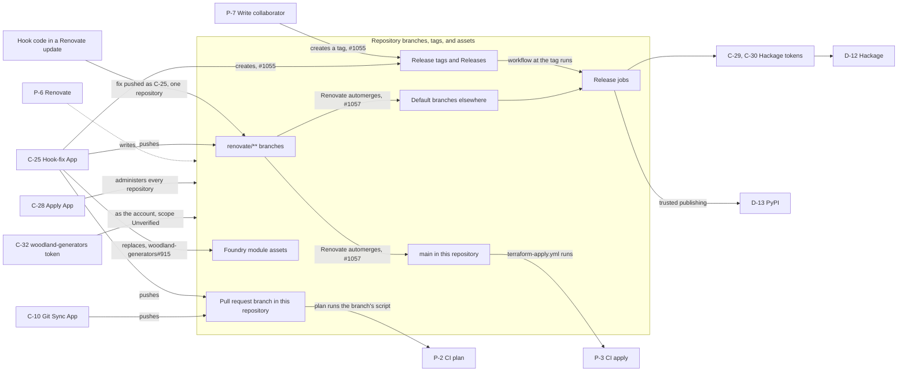
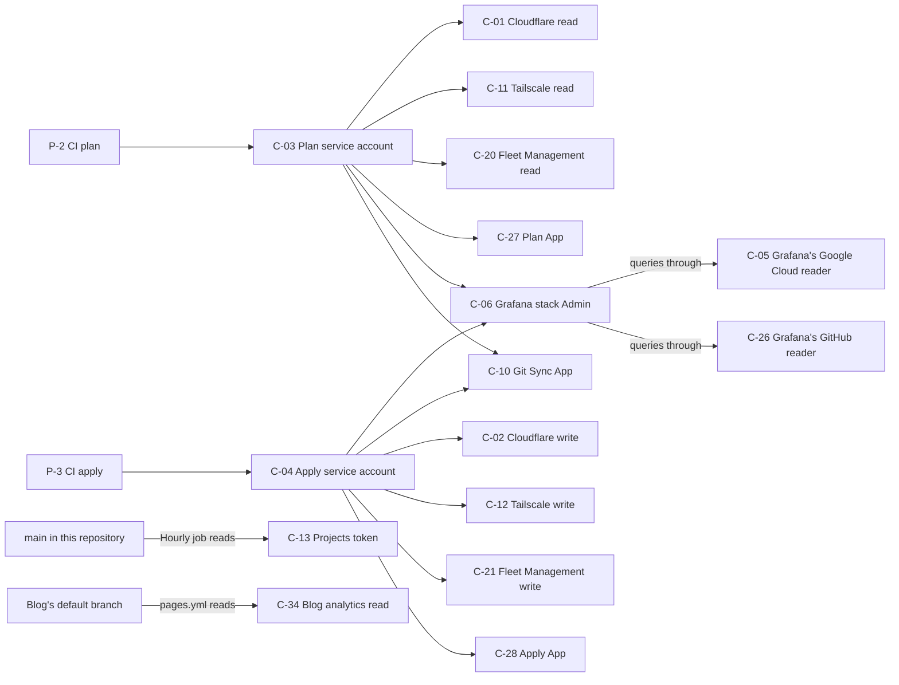

<!-- SPDX-FileCopyrightText: 2026 Alex Brandt <alunduil@gmail.com> -->
<!-- SPDX-License-Identifier: MIT -->

# Credential reachability

What someone can obtain from each credential or foothold in the estate,
following one step to the next until nothing new is reachable.

Verified 2026-11-04.

## Scope

Written for the operator weighing a new credential or judging how far a
leak spreads. It assumes the
[asset register](../reference/asset-register.md), whose IDs name every
node here.

Reachability differs from data flow. A data flow diagram draws data
that moves, while this graph draws what an actor could obtain, including
paths that have never run. The edges come from reading configuration.
None has been exercised.

Out of scope:

- P-1, which reaches every node. Drawing those edges would hide the rest.
- Paths inside T-2 hosts, including credentials on A-01 and A-02.
- Whether a change to `alunduil-chezmoi`'s default branch reaches A-06
  without review, which hasn't been traced.
- Credentials nobody has listed. Issue #542 sweeps the provider consoles.

## The graphs

An arrow means the source can obtain or act through the target. A dashed
arrow is an accepted trust in Renovate, covered
[later](#why-renovate-is-accepted). An arrow to a box applies to everything
inside it.

### From a foothold to a release

P-2 and P-3 are where this graph hands over to the next one.

### What CI holds

C-28 at the end of this graph is the same node that administers every
repository in the previous one, which is what closes the loop.

These credentials have no edge in or out, apart from P-1 and the host
that consumes them: C-07, C-08, C-14, C-15, C-16, C-17, C-18, C-19,
C-22, C-23, C-24, and C-33.

## What each foothold reaches

- Hook code in this repository's update reaches `main`, then P-3, C-28,
  and everything C-28 reaches. #1057 removes the path.
- Hook code in another repository's update reaches that repository's
  default branch and its release. #1057 removes the path.
- C-25 reaches every repository's tags and branches, P-2, P-3, and both
  registries. #1057, #1055, and `woodland-generators#915` remove those
  routes.
- P-7 on `zfs-replicate` reaches D-13 through a tag. #1055 removes that.
- P-7 on `network-arbitrary` reaches C-30 and D-12 through a tag. #1055
  removes that.
- P-7 on `collection-json.hs` reaches C-29 and D-12 through a tag. #1055
  removes that.
- P-3, C-04, and C-28 reach every repository, and so every registry.
  Terraform needs this authority, so no fix removes it.
- P-2, C-03, and C-10 reach C-01, C-06, C-10, C-11, C-20, and C-27. #501
  narrows what each job holds.
- C-32 reaches `woodland-generators` at least. #738 removes the token.
- C-29 and C-30 reach D-12 and stop there, though D-12 means every package
  the token's Hackage user can upload, not only the repository's own.
- C-13 and C-34 reach nothing further.
- P-6 reaches everything C-25 does, and that trust is accepted.

An App token from the reusable workflow covers one repository, which is
why hook code gets two entries. The C-25 key itself covers every
repository the App is installed on.

P-2 stops short of P-3 because C-04 admits only
`terraform-apply.yml` on `main`. That's the boundary keeping an unmerged
branch away from write access. P-2 still holds stack Admin through C-06.

## Where paths converge

Two nodes do most of the connecting.

C-28 is the expected hub. Terraform has to administer every repository,
so anything reaching `main` in this repository reaches everything else.
The graph's value here is showing what must not reach `main` unreviewed.

C-25 is the unexpected one. Its job is pushing formatting fixes, yet one
key joins every repository, and its commits automerge. Removing the
single edge from `renovate/**` to the default branches disconnects hook
code from everything else. C-25 then needs #1055 and
`woodland-generators#915` to lose its remaining routes to a release,
which leaves it only P-2's credentials.

This matters for any credential added later. Keeping a credential to one
repository contains a leak only if nothing else joins that repository to
the others, and today C-25 does.

Required checks don't change these edges, since they don't inspect who
wrote a commit or what it means. `renovate.json` holds back updates to
`terraform-apply.yml`'s paths, but it judges the files Renovate's upgrade
touches, so a later commit on the branch isn't held.

## Why Renovate is accepted

P-6 reaches everything C-25 does, and more, because the App holds
`contents`, `workflows`, and `checks` write on every repository. No
required check binds it, since it could edit the workflow or report the
result itself.

That trust is accepted rather than removed. Rulesets name the App by its
ID, so another actor can't claim its bypass. Compromising it means
compromising Mend, and the same compromise could already choose which
package versions these repositories run, so restricting the App further
buys little. Hook-fix differs because it runs third-party code and
commits the output, and that risk needs no compromise at Mend.

One consequence is that a path existing only through P-6 doesn't need
its own fix. Anything able to push a branch to `renovate-config` can run
any ref of `fix-renovate-hooks.yml` and read C-25, because the
provider's condition matches that file by prefix. Renovate can push
there, yet C-25 gives it nothing it lacks.
