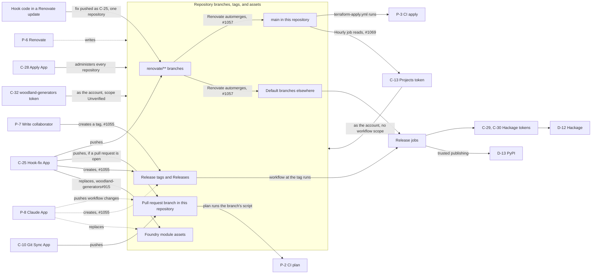
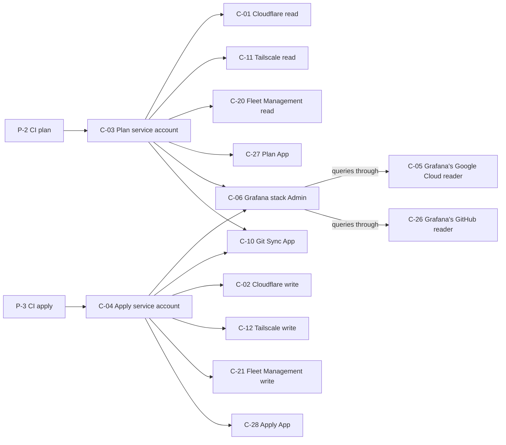

<!-- SPDX-FileCopyrightText: 2026 Alex Brandt <alunduil@gmail.com> -->
<!-- SPDX-License-Identifier: MIT -->

# Credential reachability

What someone can obtain from each credential or foothold in the estate,
following one step to the next until nothing new is reachable.

Verified 2026-11-04.

## Scope

Written for the operator weighing a new credential or judging how far a
leak spreads. It assumes the
[asset register](../reference/asset-register.md), whose IDs name every
node here.

Reachability differs from data flow. A data flow diagram draws data
that moves, while this graph draws what an actor could obtain, including
paths that have never run.

The edges come from reading configuration. Some have run in normal use, such
as a hook-fix commit automerging in `projects-v2-sync#49`, but none has been
tested as an attack.

Out of scope:

- P-1, which reaches every node. Drawing those edges would hide the rest.
- Paths inside T-2 hosts, including credentials on A-01 and A-02.
- What a vendor credential can do once used. The graph stops at C-12's
  Tailscale write, for example, without following it on to tailnet hosts.
- The Terraform state bucket, which C-03 can read and C-04 can write. The
  code keeps keys out of that state, but nobody has read it to confirm.
- Whether a change to `alunduil-chezmoi`'s default branch reaches A-06
  without review, which hasn't been traced.
- Credentials nobody has listed. Issue #542 sweeps the provider consoles.

## How credentials connect

An arrow means the source can obtain or act through the target. A dashed
arrow is an accepted trust, covered
[later](#why-renovate-and-the-claude-app-are-accepted). An arrow to a box
applies to everything inside it.

### From a foothold to a release

P-2 and P-3 are where this graph hands over to the next one.

### What CI holds

C-28 at the end of this graph is the same node that administers every
repository in the previous one, which is what closes the loop.

## What each starting point reaches

A foothold is where someone starts without holding a credential:

- Hook code in a Renovate update reaches its own repository's default
  branch and release, because the App token it pushes with covers one
  repository. In this repository that branch is `main`, which leads to CI
  apply (P-3), the Apply App (C-28), the Projects token (C-13), and
  everything those reach. #1057 removes the path.
- A write collaborator (P-7) reaches a registry by creating a release tag.
  On `zfs-replicate` that's PyPI (D-13). On `collection-json.hs` and
  `network-arbitrary` it's Hackage (D-12), through that repository's token
  (C-29 or C-30). #1055 removes these.

Each credential or identity reaches the following, widest first:

- The apply identities (P-3, C-04, C-28) reach every repository, and so
  every registry. Terraform needs this authority, so no fix removes it.
- The Projects token (C-13) acts as the account on every repository it can
  write to, in other organizations too, and bypasses the rulesets the admin
  role does. It can't edit workflow files. #1069 replaces it.
- Renovate (P-6) reaches everything the hook-fix key does, and that trust
  is accepted.
- The hook-fix key (C-25) reaches tags and branches on every repository the
  App is installed on, CI plan (P-2), CI apply (P-3), and both registries.
  #1057, #1055, and `woodland-generators#915` remove those routes.
- The Claude App (P-8) holds `contents`, `workflows`, `actions`, and
  `repository_hooks` write on every repository. It reaches tags, assets,
  and pull request branches, and so CI plan (P-2) and the registries. No
  ruleset names it, so it can't land on a default branch alone. #1055 would
  remove its tag route, and the rest of that trust is accepted.
- The plan identities (P-2, C-03) and the Git Sync App (C-10) reach the
  Cloudflare, Tailscale, and Fleet Management read credentials (C-01, C-11,
  C-20), the Plan App (C-27), the Git Sync App, and Grafana stack Admin
  (C-06). #501 narrows what each job holds. They stop short of P-3 because
  C-04 admits only `terraform-apply.yml` on `main`, which keeps an unmerged
  branch away from write access.
- The `woodland-generators` token (C-32) reaches that repository at least.
  #738 removes it.
- The Hackage tokens (C-29, C-30) reach D-12 and stop there, though that
  means every package the token's Hackage user can upload, not only the
  repository's own.
- The Codecov App (P-9) reads contents and can report checks and statuses.
  That could satisfy a required check matched by name (#429), and it leads
  nowhere further.
- The Codecov tokens (C-33) lead nowhere further, though any P-7 on the
  repository holding one can read it.

The rest have no edge in or out, apart from P-1 and the host that consumes
them: C-07, C-08, C-14, C-15, C-16, C-17, C-18, C-19, C-22, C-23, and C-24.
C-34 is the same, because nothing reads it (#1070).

## Where paths converge

Three nodes do most of the connecting.

The Apply App (C-28) is the expected hub. Terraform has to administer every
repository, so anything reaching `main` in this repository reaches
everything else.

The hook-fix key (C-25) is the unexpected one. Its job is pushing
formatting fixes, yet one key joins every repository, and its commits
automerge. Removing the single edge from `renovate/**` to the default
branches disconnects hook code from everything else. To lose its remaining
routes to a release, the key then needs #1055 and
`woodland-generators#915`, which leaves it only what CI plan holds.

Required checks don't change that edge, since they don't inspect who
wrote a commit or what it means. `renovate.json` holds back updates to
`terraform-apply.yml`'s paths, but it judges the files Renovate's upgrade
touches, so a later commit on the branch isn't held.

The Projects token (C-13) is the other surprise. It exists to update one
board, yet its `repo` scope covers every repository the account can write
to. Any merge to `main` reaches it, because the hourly job runs the script
from the checkout and that path has no review hold.

This matters for any credential added later. Keeping a credential to one
repository contains a leak only if nothing else joins that repository to
the others, and today the hook-fix key and the Projects token both do.

## Why Renovate and the Claude App are accepted

Renovate (P-6) reaches everything the hook-fix key does, and more, because
its App holds `contents`, `workflows`, and `checks` write on every
repository. No required check binds it, since it could edit the workflow or
report the result itself.

That trust is accepted rather than removed. Rulesets name the App by its
ID, so another actor can't claim its bypass. Compromising it means
compromising Mend, and the same compromise could already choose which
package versions these repositories run, so restricting the App further
buys little. Hook-fix differs because it runs third-party code and commits
the output, and that risk needs no compromise at Mend.

One consequence is that a path existing only through P-6 doesn't need
its own fix. Anything able to push workflow changes to a `renovate-config`
branch can run any ref of `fix-renovate-hooks.yml` and read C-25, because
the provider's condition matches that file by prefix. Renovate can push
there, yet the key gives it nothing it lacks.

The Claude App (P-8) is accepted for a different reason: the operator uses
it on every repository, so narrowing it now would stop that work. This
holds until sessions run with their own repo-scoped identities, which
`alunduil-chezmoi#856` is working out. Compromising it means compromising
Anthropic, so it's the same kind of trust as Mend, without the ruleset
bypass.
