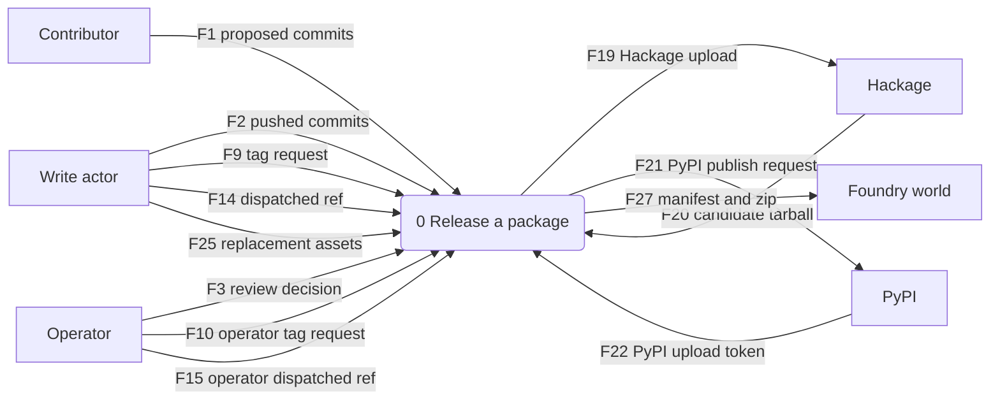
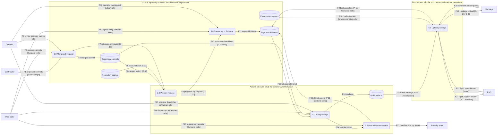

<!-- SPDX-FileCopyrightText: 2026 Alex Brandt <alunduil@gmail.com> -->
<!-- SPDX-License-Identifier: MIT -->

# Release path data flow

How a commit becomes a published package, and which credential carries it
across each trust boundary. The
[release path threat model](threat-model-release-path.md) walks these
elements.

Verified 2026-11-06.

## Scope

Written for the operator deciding where a new release credential belongs. It
assumes the [asset register](../reference/asset-register.md), whose IDs appear
here, and describes today's path. The App #556 plans appears only in the threat
model's comparison.

The diagrams cover the repositories that publish or plan to:

- `collection-json.hs`
- `network-arbitrary`
- `siren-json.hs`
- `woodland-generators`
- `zellij-claude-pair`
- `zfs-replicate`

Out of scope:

- What happens to a package after a registry accepts it.
- How a dependency reaches a pull request, apart from Renovate pushing it.
- Routes other repositories could add later. Issue #1077 keeps the inventory
  of what starts a release, and this page records what the workflows do at the
  verification date.

## Context

The system takes changes and release requests from people and automation, and
delivers packages to registries and to Foundry worlds.

The entities group principals that face the same threats:

| Entity | Principals |
| --- | --- |
| Contributor | Anyone opening a pull request, through E-04 |
| Write actor | P-5, P-6, P-7, and P-8 |
| Operator | P-1, and C-13 and C-32, which act as the account |
| Hackage | D-12 |
| PyPI | D-13 |
| Foundry world | Anyone installing the `woodland-generators` module |

## Level 0

The three trust boundaries are the repository, a job running the workflow
at a commit, and a job admitted to a deployment environment. A bracket on a flow
names the credential or permission that carries it. A flow with no bracket
stays inside one boundary or needs no credential.

Flows F5, F6, F7, F8, F12, F13, F17, F18, F23, and F26 cross between the
repository, a job, and an environment job. A job holds nothing until one of
these flows gives it something.

## How repositories differ

Each repository uses part of the diagram:

- `collection-json.hs`: `prereleased` uploads a candidate, and a dispatch on the
  tag publishes it to D-12. C-29 sits in the `hackage` environment, which admits
  `v*`.
- `network-arbitrary`: `published` publishes to D-12. C-30 sits in the `hackage`
  environment, which admits `v*`.
- `siren-json.hs`: nothing starts the path yet, because it has no `release.yml`.
  Its `hackage` environment admits any ref and holds no secret.
- `woodland-generators`: a push to `main` runs release-please with C-32. A later
  job attaches Release assets with P-11, and no environment is involved.
- `zellij-claude-pair`: nothing starts the path yet, because it has no release
  workflow.
- `zfs-replicate`: `published` publishes to D-13 through trusted publishing. Its
  `pypi` environment admits `v*.*.*`.

The operator created the latest Releases everywhere except `woodland-generators`,
where C-32 acts as the account.

The diagram draws processes rather than jobs, and three differences matter for
the threat model:

- `network-arbitrary` and `collection-json.hs`'s `candidate` job run 4.0 and
  5.0 in one job, so build code shares a job with the Hackage token.
- `woodland-generators` runs 4.0 and 6.0 in one job, so build code shares a job
  with `Contents` write.
- `zfs-replicate` runs 4.0 and 5.0 in separate jobs.

Only `collection-json.hs` refuses a tag that isn't on the default branch. That
check lives in the workflow at the tag, so it binds only an actor who can't
change workflow files.

Every Write actor can also use F9, and those holding `Actions` write can use
F14.
