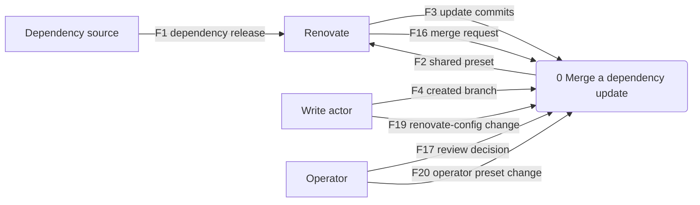
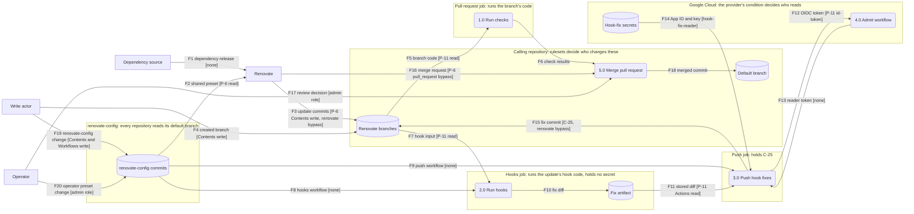

<!-- SPDX-FileCopyrightText: 2026 Alex Brandt <alunduil@gmail.com> -->
<!-- SPDX-License-Identifier: MIT -->

# Renovate path data flow

How a dependency update becomes a merged commit on a default branch, and
which credential carries it across each trust boundary. The [Renovate path
threat model](threat-model-renovate.md) walks these elements.

Verified 2026-11-21.

## Scope

Written for the operator deciding who may write to a Renovate branch or read
the hook-fix key. It assumes the [asset
register](../reference/asset-register.md), whose IDs appear here. The
self-test App #1159 plans appears only in the threat model.

The diagrams cover:

- Every repository with `renovate_automerge`, which gives Renovate its merge
  bypass and adds the `renovate` ruleset.
- `renovate-config`, whose default branch holds the shared preset and
  `fix-renovate-hooks.yml`.

Out of scope:

- What a merged commit reaches next. [Credential
  reachability](credential-reachability.md) follows `main` in this repository
  to `terraform apply`, and the [release path data
  flow](release-path-data-flow.md) follows a default branch to a registry.
- What Mend does inside Renovate.

## Context

The system takes dependency releases, branch writes, and review decisions,
and delivers merged commits to default branches.

The entities group principals that face the same threats:

| Entity | Principals |
| --- | --- |
| Dependency source | Registries and upstream repositories |
| Renovate | P-6 |
| Write actor | P-7 and P-8 |
| Operator | P-1 |

## Level 0

The six trust boundaries are:

- `renovate-config`, whose default branch every repository reads.
- A calling repository, whose rulesets decide who changes its branches.
- A pull request job, which runs the branch's code.
- The hooks job, which runs the update's hook code and holds no secret.
- The push job, which holds C-25.
- Google Cloud, where the provider's condition decides who reads the key.

A bracket on a flow names the credential or permission that carries it. A
flow with no bracket stays inside one boundary or needs no credential.

Flows F2, F5, F7, F8, F9, F11, F12, F13, F14, F15, and F19 cross a boundary.
A job holds nothing until one of these flows gives it something.

A merge in `renovate-config` is also 5.0, with `renovate-config commits` as
its default branch. F19 and F20 draw it as a direct change, because that
repository has no `admin-only` ruleset and its `review` ruleset requires no
approval.

## How repositories differ

Each repository uses part of the diagram:

- Eleven repositories set `renovate_automerge`: `alunduil-chezmoi`,
  `alunduil-infrastructure`, `blog.alunduil.com`, `collection-json.hs`,
  `git-worktree-poi`, `network-arbitrary`, `projects-v2-sync`,
  `siren-json.hs`, `woodland-generators`, `zellij-claude-pair`, and
  `zfs-replicate`. The others have no `renovate` ruleset and no merge bypass
  for Renovate, so the operator merges their updates.
- Four call `fix-renovate-hooks.yml`: `alunduil-infrastructure`,
  `projects-v2-sync`, `woodland-generators`, and `zfs-replicate`. Each pins it
  by commit with a `# main` comment and extends `:automergeDigest`, so a new
  `renovate-config` commit reaches them as an automerging digest update. The
  rest skip 2.0 through 4.0.
- `zfs-replicate` has twelve write collaborators. Every other repository here
  has only the operator, so its Write actor is P-8 alone.
- `renovate-config` neither sets `renovate_automerge` nor calls the
  workflow. #1038 plans both.

The hook-fix App's token covers only the calling repository, because the push
job names no other. Its key isn't limited that way: C-25 is installed on
every repository.
