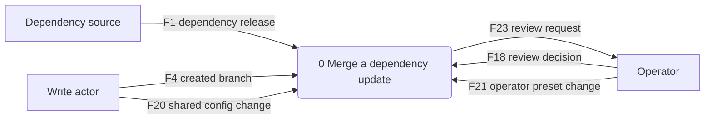

<!-- SPDX-FileCopyrightText: 2026 Alex Brandt <alunduil@gmail.com> -->
<!-- SPDX-License-Identifier: MIT -->

# Renovate path data flow

How a dependency update becomes a merged commit on a default branch, and
which credential carries it across each trust boundary. The [Renovate path
threat model](threat-model-renovate.md) walks these elements.

Verified 2026-11-21.

## Scope

Written for the operator deciding who may write to a Renovate branch or read
the hook-fix key. It assumes the [asset
register](../reference/asset-register.md), whose IDs appear here. The
self-test App that #1159 plans appears only in the threat model.

The diagrams cover:

- Every repository with `renovate_automerge`, which gives Renovate its merge
  bypass and adds the `renovate` ruleset.
- `renovate-config`, whose default branch holds the shared preset and
  `fix-renovate-hooks.yml`.

Out of scope:

- What a merged commit reaches next. [Credential
  reachability](credential-reachability.md) follows `main` in this repository
  to `terraform apply`, and the [release path data
  flow](release-path-data-flow.md) follows a default branch to a registry.
- What Mend does inside Renovate.
- How the operator stores the hook-fix key in Secret Manager.

## Context

The system takes dependency releases, branch writes, and review decisions,
and asks the operator to review the updates it holds.

The entities group principals that face the same threats:

| Entity | Principals |
| --- | --- |
| Dependency source | Registries and upstream repositories |
| Write actor | P-7 and P-8 |
| Operator | P-1 |

## Level 0

The seven trust boundaries are:

- Mend, which runs Renovate as P-6.
- `renovate-config`, whose default branch every repository reads.
- A calling repository, whose rulesets decide who changes its branches.
- A pull request job, which runs the branch's code.
- The hooks job, which runs the update's hook code and holds no secret.
- The push job, which holds C-25.
- Google Cloud, where the provider's condition decides who reads the key.

A bracket on a flow names the credential or permission that carries it. A
flow with no bracket stays inside one boundary or needs no credential.

```mermaid
flowchart LR
  source["Dependency source"]
  writer["Write actor"]
  operator["Operator"]

  subgraph mend["Mend: runs Renovate as P-6"]
    propose("1.0 Propose update")
  end

  subgraph config["renovate-config: every repository reads its default branch"]
    update_config("8.0 Update shared config")
    config_commits[("Shared config commits")]
  end

  subgraph repo["Calling repository: rulesets decide who changes these"]
    accept("2.0 Accept push")
    branches[("Renovate branches")]
    merge("7.0 Merge pull request")
    default[("Default branch")]
  end

  subgraph ci["Pull request job: runs the branch's code"]
    checks("3.0 Run checks")
  end

  subgraph hooks["Hooks job: runs the update's hook code, holds no secret"]
    run_hooks("4.0 Run hooks")
    artifact[("Fix artifact")]
  end

  subgraph push["Push job: holds C-25"]
    push_fixes("5.0 Push hook fixes")
  end

  subgraph gcp["Google Cloud: the provider's condition decides who reads"]
    admit("6.0 Admit workflow")
    secrets[("Hook-fix secrets")]
  end

  source -->|"F1 dependency release [none]"| propose
  config_commits -->|"F2 shared preset [P-6 read]"| propose
  propose -->|"F3 update commits [P-6 Contents write]"| accept
  writer -->|"F4 created branch [Contents write]"| accept
  accept -->|"F5 branch update"| branches
  branches -->|"F6 branch code [P-11 read]"| checks
  checks -->|"F7 check results"| merge
  branches -->|"F8 hook input [P-11 read]"| run_hooks
  config_commits -->|"F9 hooks workflow [none]"| run_hooks
  config_commits -->|"F10 push workflow [none]"| push_fixes
  run_hooks -->|"F11 fix diff"| artifact
  artifact -->|"F12 stored diff [none]"| push_fixes
  push_fixes -->|"F13 OIDC token [P-11 id-token]"| admit
  admit -->|"F14 reader token [none]"| push_fixes
  secrets -->|"F15 App ID and key [hook-fix-reader]"| push_fixes
  push_fixes -->|"F16 fix commit [C-25]"| accept
  propose -->|"F17 merge request [P-6 pull_request bypass]"| merge
  operator -->|"F18 review decision [admin role]"| merge
  merge -->|"F19 merged commit"| default
  writer -->|"F20 shared config change [Contents and Workflows write]"| update_config
  operator -->|"F21 operator preset change [admin role]"| update_config
  update_config -->|"F22 shared config commit"| config_commits
  propose -->|"F23 review request [none]"| operator
```

Flows F2, F3, F6, F7, F8, F9, F10, F12, F13, F14, F15, F16, and F17 cross
between these boundaries. A job holds nothing until one of these flows gives
it something.

2.0 is GitHub applying the `renovate` ruleset: Renovate and the hook-fix App
bypass its `update` rule, and nothing stops a write actor creating a branch.
8.0 is a push or merge to `renovate-config`'s default branch. That repository
has no `admin-only` ruleset, and its `review` ruleset requires no approval.

## How repositories differ

Each repository uses part of the diagram:

- Eleven repositories set `renovate_automerge`: `alunduil-chezmoi`,
  `alunduil-infrastructure`, `blog.alunduil.com`, `collection-json.hs`,
  `git-worktree-poi`, `network-arbitrary`, `projects-v2-sync`,
  `siren-json.hs`, `woodland-generators`, `zellij-claude-pair`, and
  `zfs-replicate`. The others have no `renovate` ruleset and no merge bypass
  for Renovate, so the operator merges their updates.
- Four call `fix-renovate-hooks.yml`: `alunduil-infrastructure`,
  `projects-v2-sync`, `woodland-generators`, and `zfs-replicate`. Each pins it
  by commit with a `# main` comment and extends `:automergeDigest`, so a new
  `renovate-config` commit reaches them as an automerging digest update. The
  rest skip 4.0 through 6.0.
- Write collaborators: `zfs-replicate` has twelve, `network-arbitrary` two,
  and `collection-json.hs` and `siren-json.hs` one each. Every other
  repository here has only the operator, so its Write actor is P-8 alone.
- `renovate-config` neither sets `renovate_automerge` nor calls the
  workflow.

The hook-fix App's token covers only the calling repository. Its key, C-25,
covers every repository, because the App is installed on all of them.
